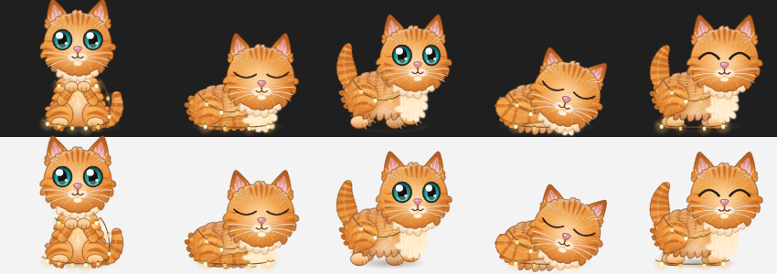
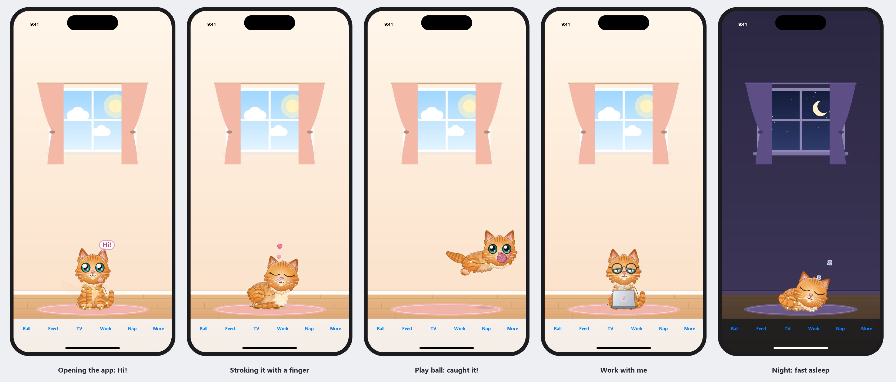

# Mochi – a fluffy golden tabby kitten that lives on your desktop

Mochi is a small, fluffy golden tabby kitten with big teal eyes (and a string of twinkling fairy lights) that
lives on your Windows desktop. It sits on top of your
taskbar with its tail tucked around its paws, wanders around, curls up for a nap when you step away, wakes up
and greets you when you come back, and purrs when you stroke its head. It is a native desktop app (not a
website, GIF or screensaver), it is drawn live in HD at any size, and it stays out of the way of your work.
There is also an [iPhone and iPad version](#iphone-and-ipad) with the same kitten.



## Install

| Option | How |
|---|---|
| **Installer (recommended)** | Download `Mochi-Setup.exe` from the [latest release](https://github.com/CloudKnowledge/Desktop-Buddy/releases/latest) (or build it yourself: `dist\Mochi-Setup.exe`) and run it. Installs for your user only (no admin) to `%LOCALAPPDATA%\Programs\Mochi`, adds a Start-menu shortcut and an entry in **Settings → Apps** and starts Mochi. |
| **Portable** | Download `Mochi.exe` from the same release (or `dist\Mochi.exe`) and run it from anywhere. |
| **Uninstall** | **Settings → Apps → Mochi – desktop kitten → Uninstall** (or run `Mochi.exe --uninstall`). It offers to delete settings/memories too. |

Both executables are self-contained (no .NET installation needed) and run on Windows 10 (2004+) and Windows 11.
On the very first launch a small Welcome window asks for a name, personality and coat, and whether Mochi should
start when you sign in (off unless you tick it).

## Playing with Mochi

| You do | Mochi does |
|---|---|
| Turn on / wake the laptop, or unlock it after a while | Sits up facing you, waves a paw and says **"Hi!"** (with *Start with Windows* on, that's every time you sign in – it waits until you touch the mouse or keyboard so you don't miss it) |
| Right-click → **Play ball** (or click the ball) | Throws the yarn ball in a high arc: Mochi races to where it will land, springs up and **catches it in mid-air** (now and then it bonks off its nose), trots back with it in its mouth, drops it at your pointer – "Again!" |
| Drag the ball and let go | Throw it yourself – fast, slow, high or low; it bounces off the screen edges and Mochi goes after it |
| Leave the ball lying about | Now and then Mochi bats it around, stalks it and pounces on it by itself. **Put the ball away** from the menu |
| Chase Mochi with the pointer along the taskbar | A game of chase: it scampers off glancing back at you, play-bows (bottom up, tail swishing) and waits for you to come again. Click it to catch it – "You got me!" |
| Right-click → **Feed Mochi** → milk or treats | A saucer of milk (lapping) or a bowl of fishy treats (crunch, crunch), then lip-licking and "Yum!" |
| Right-click → **Watch cat TV** | A little retro TV shows fish or a bird; Mochi's eyes follow every move, it chirps and paws at the screen, and a sleepy kitten may nod off in front of it |
| Right-click → **Work with me** | Puts on round glasses, opens a tiny laptop and types away with its paws, pausing now and then to think ("meow-ting?", "ship it!"), then "Break time!" – sometimes off for a saucer of milk |
| Click | Looks at you, mews or sends a heart, a little happy hop with a head bump and a slow blink (sometimes a wink) |
| Click quickly several times | Gets the kitten crazies – arched, puffed-up sideways crab hops |
| Click 10 times in a row | 🎉 Secret celebration: kneading, a backflip and a crab dance |
| Double-click | A twisting kitten leap with hearts |
| Hover gently back and forth over its head | Petting: eyes close, it purrs (you can see the purr), leans in and soon starts kneading |
| Stroke its back while it loafs or sleeps | It purrs – asleep, it purrs in its sleep instead of waking |
| Press and hold, or drag | Picks Mochi up – a dangly "liquid cat" that swings like a pendulum |
| Let go / fling | Falls with gravity, twists round and always lands on its feet; after a big drop it grooms as if it meant to do that, after a fling it pounces |
| Wiggle the pointer near it | Prey instinct: it crouches, wiggles its bottom and pounces |
| Move the pointer near it | Watches the pointer, tilts its head when curious; a sudden swipe right past it makes it jump with an arched back |
| Leave the PC for ~1.5 min / ~4 min | Gets drowsy in a loaf (yawns, fights to keep its eyes open) / curls up into a ball, tail over its nose, with Zzz and dreams of fish and yarn |
| Come back | Wakes up gradually (flutter, stretch, head shake); trots over and greets you after a long break or in the morning |
| Right-click Mochi or the tray icon | Menu: pet, feed, cat TV, work, play ball, sleep/wake, follow cursor, come here, personality, look, size, ghost mode, settings, hide, exit |
| Left-click tray icon | Calls Mochi over (or shows it if hidden). Double-click opens Settings |
| Run `Mochi.exe --ball` (e.g. from a shortcut) | Throws the ball for Mochi right away |

Mochi also has a life of its own: it sits facing you (sometimes holding its paws up to its chest), sits side-on
with its tail wrapped round its paws, loafs, wanders, gets the
zoomies, grooms, stretches, chases its tail, gives you slow blinks (cat kisses), bleps, stares at nothing,
kneads, chatters at birds only it can see, swats, sneezes, dozes off, takes naps, has a snack of milk or
treats every so often, settles down to watch cat TV, works on its laptop (more often while you're busy too),
plays with its ball and more – with randomised timing and
cool-downs so it never loops robotically and never demands attention.

## iPhone and iPad

The iPhone/iPad app ([src/Mochi.iOS](src/Mochi.iOS)) shares Mochi's brain, drawing and ball physics with the Windows
app. iOS doesn't let an app float on top of other apps, so on a phone Mochi lives in its own cosy room, whose
window shows the sky by day and the moon and stars at night.



| You do | Mochi does |
|---|---|
| Open the app, or come back to it after a couple of minutes | Waves and says **"Hi!"** |
| Tap Mochi / double-tap / tap many times | A happy hop / a twisting leap / the kitten crazies (10 taps: secret celebration) |
| Stroke its head with a finger | Closes its eyes, purrs, leans in and kneads |
| Press and hold Mochi, then drag and let go | Picks it up (it dangles and swings); a flick sends it flying and it lands on its feet |
| Slide a finger quickly along the floor towards it | A game of chase: it scampers off, looks back and play-bows |
| **Ball** button, or tap the ball | Throws the yarn ball: Mochi catches it in mid-air and brings it back. Flick the ball to throw it yourself; press and hold the button to put it away |
| **Feed**, **TV**, **Work**, **Nap** | Milk or treats, cat TV, work mode (glasses and a laptop), sleep / wake up |
| **More** | Pet, say hi, coat and accessory |

Settings and memories stay on the device.

## Settings

Right-click → **Settings…** (Windows 11 Fluent style, applies instantly):

* **Character** – name, coat (Golden, Cream, Ginger, Silver tabby), fairy lights, bell collar or hair bow (and the collar/bow colour), size.
* **Personality** – Playful, Lazy, Curious, Shy, Affectionate or Mischievous, plus what Mochi has learned
  (petting makes it more affectionate, teasing more mischievous; bounded and never guilt-tripping).
* **Animation & behaviour** – liveliness, hearts/Zzz effects, 60 fps or battery-saver 30 fps.
* **Sleep schedule** – auto-nap on/off, drowsy and sleep timings.
* **Desktop & startup** – start when I sign in, hide from screen sharing, hide during full-screen apps, ghost mode.
* **Privacy** – what Mochi does and does not do, open the data folder, forget everything.

Settings live in `%APPDATA%\Mochi\settings.json`, memories in `%APPDATA%\Mochi\memory.json`, logs in
`%LOCALAPPDATA%\Mochi\logs`.

## Privacy

* Presence detection uses only the Windows idle timer (`GetLastInputInfo` – a timestamp). No key logging,
  no hooks, no camera, no microphone, no screenshots or screen recording.
* The pointer position is read each frame so Mochi can look at it; it is never stored.
* No network access, no accounts, no telemetry. Mochi never keeps the PC awake.
* **Hide from screen sharing** (on by default) makes Mochi invisible in Teams/Zoom shares, screenshots
  and recordings while you still see it.

## Build from source

Requirements: Windows 10/11 and the .NET 10 SDK.

```powershell
dotnet build Mochi.slnx                       # build everything
dotnet test tests/Mochi.Core.Tests            # 80 unit tests: behaviour, gestures, touch, physics, ball play, persistence, rendering
dotnet run --project src/Mochi.App            # run Mochi from source
dotnet run --project tools/Mochi.Preview      # render pose contact sheets to preview-out/ (+ timing); --pose <name> for one big pose
dotnet run --project tools/Mochi.Preview -- preview-out --phone   # iPhone screens from the touch-screen host
pwsh -File build/publish.ps1                  # tests + self-contained dist/Mochi.exe and dist/Mochi-Setup.exe
```

### iPhone / iPad app

Building an iOS app needs a Mac with Xcode, plus the .NET 10 SDK with the iOS workload (`dotnet workload install ios`):

```bash
dotnet build src/Mochi.iOS -t:Run                                  # build and run in the iOS Simulator
dotnet build src/Mochi.iOS -t:Run -p:RuntimeIdentifier=ios-arm64    # on a connected iPhone/iPad (needs code signing)
```

For a real device, set `CFBundleIdentifier` in [src/Mochi.iOS/Info.plist](src/Mochi.iOS/Info.plist) to an app ID your
Apple developer team owns, with a matching provisioning profile installed through Xcode. `Mochi.iOS.slnx` opens the iOS
app together with the shared core and its tests in Rider or VS Code (C# Dev Kit + .NET MAUI extension).

Project layout (details in [docs/ARCHITECTURE.md](docs/ARCHITECTURE.md)):

```
src/Mochi.Core      platform-neutral: rig + renderer, animator, behaviour state machine, gestures, effects, persistence,
                    and the touch-screen stage (room, touch input, view layout) used by the iPhone/iPad app
src/Mochi.App       Windows host: layered window, tray/menus, settings (WPF Fluent), installer, idle/lock/fullscreen detection
src/Mochi.iOS       iPhone/iPad host: room, kitten and ball views, toolbar, touches, frame loop (Mochi.iOS.slnx)
tools/Mochi.Preview visual QA contact sheets, iPhone screens, and app-icon generation
tests/              xUnit tests for Mochi.Core
```

## Troubleshooting

| Symptom | Fix |
|---|---|
| Mochi disappeared | Left-click the tray icon (it may be hidden, or a full-screen app/slide show is running – it comes back afterwards). Launching Mochi again also calls it over. |
| Can't click things behind Mochi | Drag Mochi elsewhere, or turn on **Ghost mode** (tray menu) so clicks pass through. |
| Ghost mode is on and I can't right-click Mochi | Use the tray icon menu to turn it off. |
| Mochi isn't in my screen share / screenshot | That's **Hide from screen sharing** – turn it off in the menu if you want to show Mochi off. |
| Mochi doesn't fall asleep | Check **Sleep schedule → Nap when I'm away**. Any key press or mouse move (including from tools that "jiggle" the mouse) counts as activity. |
| Mochi is too big/small | Right-click → **Size**, or the size slider in Settings. It also adapts to each monitor's DPI. |
| SmartScreen warns about the installer | The build is not code-signed. Choose **More info → Run anyway**, or build it yourself from source. |
| Something odd happened | See `%LOCALAPPDATA%\Mochi\logs\mochi.log`. Corrupt settings are backed up as `*.corrupt` and reset to defaults. |

## Status

### Completed (Phase 1 – living kitten MVP, plus extras)

- [x] Original HD golden tabby kitten art: procedural 2D skeletal rig, fluffy fur with tabby markings, big glossy teal eyes with dilating cat pupils, toe beans, side-on and square-on (front-facing) bodies, 4 tabby coats, twinkling fairy lights, bell collar or hair bow in 6 colours
- [x] Transparent, frameless, always-on-top, no-taskbar window with per-pixel click-through; never steals focus
- [x] Idle micro-behaviours, sitting with the tail wrapped, loafing, walking, zoomies, grooming, kneading, stalking and pouncing, tricks and surprises
- [x] Drowsy → sleep → dreaming cycle driven by the OS idle timer; gradual wake-up; greetings after breaks and in the morning
- [x] Click, rapid clicks, double-click, 10-click Easter egg, head petting with purring and kneading, pick-up with pendulum swing, drop/throw with gravity, righting reflex and landing
- [x] Pointer-following eyes/head, curiosity, prey instinct (stalk and pounce on a wiggling pointer), follow-cursor mode, "come here"
- [x] Personalities with bounded learning, persisted memory and position
- [x] Tray icon and Windows 11-style menus; Fluent settings window; first-run welcome
- [x] Multi-monitor and per-monitor DPI aware floors; survives taskbar/resolution changes
- [x] Hide from screen capture, auto-hide during presentations/full-screen apps (not over remote desktops), ghost mode
- [x] Opt-in start-up, per-user installer and uninstaller, single instance, crash-tolerant persistence and logging
- [x] Adaptive frame rate (60/30/16 fps), pauses when hidden, locked or the display is off; ~1.5 ms per frame
- [x] Settings saved by the earlier puppy build are migrated automatically (bandana → hair bow, collar → bell collar, red golden → ginger)

### Pending (next phases)

- [x] Phase 2: yarn ball – throw it (menu, click or drag-and-fling), physics with bounces and rolling, mid-air catches, fetch back to you, solo batting/stalking/pouncing
- [x] Saying "Hi!" with a wave at sign-in and when the laptop wakes; snacks (milk, treats); cat TV; working on a laptop; game of chase with the pointer
- [x] iPhone and iPad app sharing the same kitten, brain and ball: a room with day and night, touch gestures and a toolbar
- [ ] Phase 2: a feather wand toy
- [ ] Phase 2: optional sound effects (soft mews and purring, muted by default) with volume control
- [ ] Phase 3: belly-up roll ("trap"), more Easter eggs, richer learned behaviours
- [ ] Phase 4: climbing and sitting on window edges, a cardboard box to sit in, more accessories/skins, focus/Pomodoro and stretch reminders, low-battery reaction
- [ ] Phase 4: walking across monitor boundaries (today Mochi stays on the monitor it is on, but can be carried anywhere)
- [ ] Phase 5: code signing, MSIX/winget packaging, auto-update, macOS host (Mochi.Core is already platform-neutral)

### Acceptance criteria

| Criterion | Status |
|---|---|
| Appears on the actual desktop, genuinely transparent, above normal windows | ✅ verified on the desktop |
| Can be moved with the mouse; remembers its position after restart | ✅ verified |
| Natural idle animation; walks independently | ✅ verified |
| Sleeps after inactivity; wakes when you return | ✅ unit-tested with simulated idle time; live wake path exercised |
| Responds to clicks; can be picked up and dragged | ✅ verified on the desktop |
| Reacts to head petting | ✅ unit-tested (gesture recogniser + behaviour); hover petting needs a real pointer to try live |
| Stalks and pounces on a wiggling pointer | ✅ unit-tested |
| Ball: thrown, chased, caught in mid-air, fetched back; batted about when left lying | ✅ unit-tested + simulated film (`Mochi.Preview --life`) |
| Says "Hi!" on sign-in/wake; snacks; cat TV; work; chase game | ✅ unit-tested |
| iPhone/iPad app | ✅ touch host unit-tested and rendered (`Mochi.Preview --phone`); iOS code compiles against the iOS 26 SDK. Still to do: a first run on a Mac / iPhone |
| Right-click menu and tray controls work | ✅ built; menu items exercised via the brain commands |
| Launches reliably; single instance; installer/uninstaller | ✅ verified |
| No unnecessary background resource use | ✅ ~18 MB working set, <0.5 % total CPU active, paused when hidden/locked/display off |
| No privacy-invasive monitoring | ✅ idle timestamp + pointer position only; no network |
| Settings persist across restarts | ✅ verified |
| Feather wand, sound mute | ⏳ Phase 2 |
